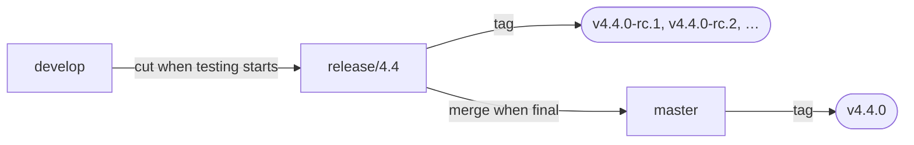
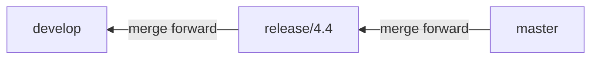
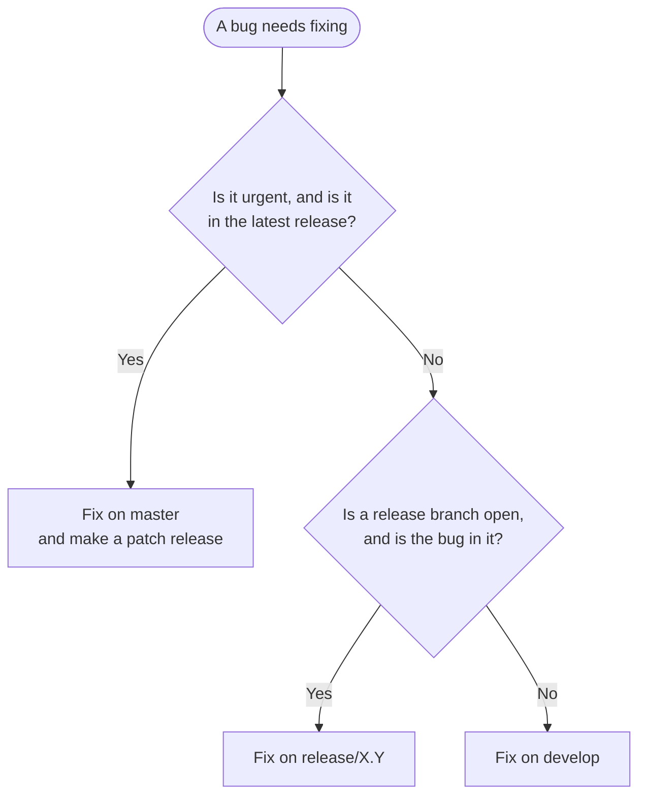
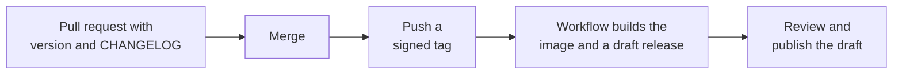

# Release process

This page is for the maintainers who publish Hajk releases. For what a release means to the organisations running Hajk, see [Releases](releases.md). For how security issues are handled, see [SECURITY.md](../SECURITY.md) and the [Security FAQ](security-faq.md). This process follows the rules described there.

The examples use **4.3.0** as the current release, **4.4.0** as the next minor release and **4.3.1** as a patch release.

## Overview

### Kinds of release

| Kind  | Example | Contains                                | Made from     | Release candidates |
| ----- | ------- | --------------------------------------- | ------------- | ------------------ |
| Major | `5.0.0` | Breaking changes                        | `release/5.0` | Yes, at least one  |
| Minor | `4.4.0` | New features and fixes                  | `release/4.4` | Yes, at least one  |
| Patch | `4.3.1` | Urgent fixes to the latest release only | `master`      | No                 |

Release candidates are only made for minor and major releases, so their version always ends in `.0-rc.N`, for example `4.4.0-rc.1`.

### Branches

| Branch        | Contains                                                                                                |
| ------------- | ------------------------------------------------------------------------------------------------------- |
| `develop`     | Ongoing development. New features are merged here.                                                      |
| `release/X.Y` | The next minor or major release while it is being tested. It exists only during the release candidates. |
| `master`      | The latest release, plus fixes waiting for its next patch release.                                      |

### How code moves between the branches

**New features** move from `develop` to `master`, one release at a time. The release branch is cut from `develop` when testing starts, and **merged into `master` when the release is final**:



**Fixes** move the other way. They are made on the oldest branch that needs them and merged forward:



This keeps `master` free from release candidates and unfinished work, so `master` and the `nightly-master` image always contain the latest final release.

### Where should a fix go?



Security vulnerabilities have their own rules, see [Security fixes](#security-fixes).

## Rules

- **Fixes are merged forward**: `master` → `release/X.Y` → `develop`. Never fix something on `develop` and cherry-pick it into a release. `develop` changes too quickly for that.
- **`develop` is never merged into `master`** or into an existing release branch.
- **The version in `package.json` is the release number.** When a commit is tagged, `apps/client`, `apps/admin` and `apps/backend` all have the version of the tag, including any `-rc.N` part.
- **A published release never changes.** Never move or re-use its tag. If a release turns out to be broken, publish a new one.
- **The CHANGELOG is the source of truth.** The release notes on GitHub are taken from it.
- **Only the latest release is patched** (see [Supported versions](../SECURITY.md#supported-versions)).
- **Everything goes through a pull request**, on release branches too.

## Step by step

Release candidates, releases and patch releases all end the same way:



The workflow runs automatically, see [What the release workflow does](#what-the-release-workflow-does). Always create the tag with `git push`, never with **Create new tag on publish** on the releases page.

### Creating a release candidate

#### First release candidate

1. **Check that `develop` is ready.** Everything for the release is merged, the build passes etc.
2. **Create the release branch** from `develop`:

   ```bash
   git fetch origin
   git switch -c release/4.4 origin/develop
   git push --set-upstream origin release/4.4
   ```

3. **Prepare the release candidate** on a branch of its own:

   ```bash
   git switch -c prepare/4.4.0-rc.1 origin/release/4.4
   ```

   - Set the version in all three apps:

     ```bash
     for app in client admin backend; do (cd apps/$app && npm version 4.4.0-rc.1 --no-git-tag-version); done
     ```

   - In the CHANGELOG, rename the **Unreleased** heading to `## [4.4.0-rc.1] YYYY-MM-DD`, and add its compare link at the bottom of the file:

     ```markdown
     [4.4.0-rc.1]: https://github.com/hajkmap/Hajk/compare/v4.3.0...v4.4.0-rc.1
     ```

   - Commit (`git commit -S`), push, and open a pull request into **`release/4.4`**.

4. **Merge the pull request** once it is approved.
5. **Tag the release candidate** on the release branch:

   ```bash
   git switch release/4.4 && git pull
   git tag -s v4.4.0-rc.1 -m "Hajk 4.4.0-rc.1"
   git push origin v4.4.0-rc.1
   ```

6. **Wait for the release workflow** to finish under the repository's **Actions** tab.
7. **Publish the draft.** Open the draft release `v4.4.0-rc.1` on the [releases page](https://github.com/hajkmap/Hajk/releases) and check the notes and the two zip packages. It is already marked as a pre-release.
   - Tick **Create a discussion for this release**. This creates a discussion thread for the release candidate, linked from the release, where testers report problems.
   - Optionally, click **Generate release notes** to add the pull requests and contributors below the notes.
   - Click **Publish release**.
8. **Ask for testing.** Let the organisations running Hajk know that the release candidate is out, and ask them to report problems in its discussion thread.

#### Fixing problems found in testing

Follow the release candidate's discussion thread. When a reported problem needs fixing, create an issue for it and link it in the thread, then:

1. **Fix on the release branch**, not on `develop`:

   ```bash
   git switch -c fix/1234-describe-the-fix origin/release/4.4
   ```

   Add the CHANGELOG entry under a new **Unreleased** heading at the top of the CHANGELOG, and open the pull request into **`release/4.4`**.

2. **Merge `release/4.4` into `develop`** regularly, through a pull request with a merge commit, so the fixes reach `develop` too. If the CHANGELOG conflicts, keep the entries from both branches.

#### Next release candidate

Repeat steps 3–8 of [First release candidate](#first-release-candidate) with the next number, `4.4.0-rc.2`. Its CHANGELOG section lists the fixes made since `4.4.0-rc.1` (they are under **Unreleased**), and its compare link is `v4.4.0-rc.1...v4.4.0-rc.2`. Each release candidate gets its own discussion thread.

### Creating the release

1. **Check that the last release candidate is ready.** It has been tested and its discussion thread has no unresolved blocking problems.
2. **Prepare the release** on a branch of its own:

   ```bash
   git switch -c prepare/4.4.0 origin/release/4.4
   ```

   - Set the version in all three apps:

     ```bash
     for app in client admin backend; do (cd apps/$app && npm version 4.4.0 --no-git-tag-version); done
     ```

   - In the CHANGELOG, add `## [4.4.0] YYYY-MM-DD` with any changes since the last release candidate, and its compare link (`v4.4.0-rc.2...v4.4.0`).
   - Commit (`git commit -S`), push, and open a pull request into **`release/4.4`**. Merge it once it is approved.

3. **Merge the release branch into `master`.** Open a pull request from `release/4.4` into **`master`**, and merge it with a merge commit once it is approved. This is what brings the release to `master`.
4. **Tag the release** on `master`:

   ```bash
   git switch master && git pull
   git tag -s v4.4.0 -m "Hajk 4.4.0"
   git push origin v4.4.0
   ```

5. **Wait for the release workflow** to finish under the **Actions** tab.
6. **Publish the draft.** Open the draft release `v4.4.0`, check the notes and the two zip packages, make sure **Set as the latest release** is ticked, and click **Publish release**.
7. **Merge `master` into `develop`** through a pull request with a merge commit. If it conflicts:
   - CHANGELOG: keep `develop`'s new **Unreleased** entries above the released versions, and let the `[unreleased]` compare link start from `v4.4.0`.
   - `package.json`: keep `4.4.0`, or the higher version `develop` already has.
8. **Delete the `release/4.4` branch.**
9. **Update the [roadmap](../ROADMAP.md)** if the release completes items on it, and announce the release.

### Creating a patch release

A patch release (4.3.0 → 4.3.1) contains only urgent fixes to the latest release. It has no release candidate and is made from `master`.

1. **Branch from `master`**, so that unreleased work stays out of the patch:

   ```bash
   git switch -c hotfix/4.3.1 origin/master
   ```

2. **Fix the problem and prepare the release** on the same branch:
   - Make the fix.
   - Set the version in all three apps:

     ```bash
     for app in client admin backend; do (cd apps/$app && npm version 4.3.1 --no-git-tag-version); done
     ```

   - In the CHANGELOG, add `## [4.3.1] YYYY-MM-DD` with the fix, and its compare link (`v4.3.0...v4.3.1`).
   - Commit (`git commit -S`), push, and open a pull request into **`master`**.

3. **Merge the pull request** once it is approved.
4. **Tag the release** on `master`:

   ```bash
   git switch master && git pull
   git tag -s v4.3.1 -m "Hajk 4.3.1"
   git push origin v4.3.1
   ```

5. **Wait for the release workflow** to finish under the **Actions** tab.
6. **Publish the draft.** Open the draft release `v4.3.1`, check the notes and the two zip packages, make sure **Set as the latest release** is ticked, and click **Publish release**.
7. **Merge `master` forward** into the open release branch, if there is one, and into `develop`, through pull requests with merge commits. Otherwise the fix is lost in the next release. If the `package.json` versions conflict, keep the branch's own, higher version (for example `4.4.0-rc.1` on `release/4.4`).

### Security fixes

Security fixes follow the [disclosure policy](../SECURITY.md#disclosure-policy). Vulnerabilities are never discussed in public issues or pull requests before the fix is released.

**Severe vulnerabilities** get a [patch release](#creating-a-patch-release), with these differences:

1. **Prepare the fix in private.** Create a temporary private fork from the GitHub security advisory, and make the fix and the pull request into `master` there. Keep the CHANGELOG entry and the pull request description free of details that would help an attacker.
2. **Merge and release.** Merge the fix from the private fork, then tag and publish the patch release right away.
3. **Publish the [security advisory](https://github.com/hajkmap/Hajk/security/advisories)**, with a CVE when warranted, and credit the reporter unless they prefer not to be named.
4. **Add the entry under Security** in the CHANGELOG, link the advisory, and add it to the release notes.
5. **Merge `master` forward** into the open release branch and `develop`.

**Less severe vulnerabilities** ship with the next release. Fix them on the open release branch if there is one, otherwise on `develop`.

## Reference

### What the release workflow does

Pushing a tag that starts with `v` runs the [release workflow](../.github/workflows/release.yml):

1. **Checks the tag.** A release (`v4.4.0`) must point to a commit on `master`. A release candidate must look like `vX.Y.0-rc.N` and point to a commit on `release/X.Y`. The version in all three `package.json` files must match the tag. If anything is wrong, nothing is published.
2. **Publishes the Docker image** to `ghcr.io/hajkmap/hajk` for `linux/amd64` and `linux/arm64`, with the tags described in [Docker images](releases.md#docker-images).
3. **Creates a draft release** on the [releases page](https://github.com/hajkmap/Hajk/releases). It takes the release notes from the version's section in the CHANGELOG, and attaches the `nodejs` and `simple` zip packages built by [`scripts/create-release.mjs`](../scripts/create-release.mjs) after a clean install of the dependencies. Release candidates are marked as pre-releases.

The release is not public until you publish the draft. With immutable releases, files cannot be added to a release once it is published, which is why the workflow attaches the packages while it is a draft.

### If the workflow fails

- **The tag check fails**, for example because a `package.json` version is wrong: nothing has been published. Delete the tag (`git push --delete origin v4.4.0` and `git tag -d v4.4.0`), fix the problem through a pull request, and tag again.
- **A later step fails**, for example because of a network error: click **Re-run failed jobs** on the run under the **Actions** tab. If the draft release already exists, the packages are uploaded to it again.
