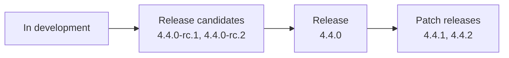

# Releases

This page describes which version of Hajk you should run, how Hajk is versioned, and what you can download. It is written for organisations that run Hajk. Maintainers who publish releases follow the [release process](release-process.md).

For how security fixes are handled, see [SECURITY.md](../SECURITY.md) and the [Security FAQ](security-faq.md). This page follows the rules described there.

> [!TIP]
> **In short:** Run the **latest release**, marked **Latest** on the [releases page](https://github.com/hajkmap/Hajk/releases). Only the latest release gets fixes, including security fixes, so upgrade when a new one is out. To hear about new releases, see [Getting notified](#getting-notified).

## How a release comes about

1. **In development.** New features are added to the `develop` branch, which is built every night as the [`nightly-develop`](#nightly-builds) image.
2. **Release candidates.** When the next minor or major release is ready for testing, it is published as one or more release candidates. Organisations test them in their own environments and report problems in each release candidate's discussion thread.
3. **Release.** When the last release candidate has been tested, the final release is published and becomes the latest release.
4. **Patch releases.** If an urgent problem, such as a security vulnerability, is found in the latest release, it is fixed in a patch release. Patch releases have no release candidates.

## Which version should we run?

| What you can run                 | What it is for                                                |        Use in production?         |
| -------------------------------- | ------------------------------------------------------------- | :-------------------------------: |
| Latest release (`4.3.1`)         | Everyone                                                      |                Yes                |
| Release candidate (`4.4.0-rc.1`) | Testing the next release in a test environment                |                No                 |
| Nightly build of `master`        | The latest release, rebuilt every night on a fresh base image | Yes, see [below](#nightly-builds) |
| Nightly build of `develop`       | Trying out upcoming features and reporting problems           |                No                 |
| An older release (`4.2.0`)       | Nothing. Upgrade to the latest release                        |                No                 |

Older releases, such as 4.2.x after 4.3.0 is out, are not patched. If you run an older release, the fix is to upgrade. See [Supported versions](../SECURITY.md#supported-versions) in SECURITY.md.

## Version numbers

Hajk follows [Semantic Versioning](https://semver.org/). Take `4.3.1` as an example:

| Part        | Example | Changes when                                                                       |
| ----------- | ------- | ---------------------------------------------------------------------------------- |
| Major       | `4`     | A release has breaking changes, such as a new configuration format or API version. |
| Minor       | `4.3`   | A regular release with new features and fixes.                                     |
| Patch       | `4.3.1` | A small release with urgent fixes only, often for a security vulnerability.        |
| Pre-release | `-rc.1` | It is a release candidate of a minor or major release, for example `4.4.0-rc.1`.   |

Every release is tagged in Git with a `v` prefix (`v4.3.1`) and published on the [releases page](https://github.com/hajkmap/Hajk/releases). All changes, including security fixes, are listed in the [CHANGELOG](../CHANGELOG.md). Read the **Breaking** section of a major release before upgrading.

## Release candidates

Release candidates are marked **Pre-release** on the releases page. They let you test the coming version in your own environment before it is final. They are not meant for production.

Each release candidate has its own thread in [GitHub Discussions](https://github.com/hajkmap/Hajk/discussions), linked from the release on the releases page. Report problems you find there. The maintainers create issues for the problems that need fixing before the final release. Security problems are never reported in the thread. Report them as described in [SECURITY.md](../SECURITY.md).

Testing a release candidate is one of the most useful ways to contribute to Hajk.

## Downloads

Each release on the releases page includes two pre-built packages:

| Package                  | Contains                                                             |
| ------------------------ | -------------------------------------------------------------------- |
| `hajk-vX.Y.Z-nodejs.zip` | Backend, Client and Admin, to run with Node.js.                      |
| `hajk-vX.Y.Z-simple.zip` | Client only, as static files, for simple setups without the Backend. |

The [installation guide](https://github.com/hajkmap/Hajk/wiki/Installation-guide-%28for-pre-packaged-releases%29) explains how to install them.

## Docker images

Official Docker images are published as `ghcr.io/hajkmap/hajk` on the GitHub Container Registry. Each image contains Backend, Client and Admin, and runs on both `linux/amd64` and `linux/arm64`.

| Tag               | Contains                                  | Updated                                 |
| ----------------- | ----------------------------------------- | --------------------------------------- |
| `4.3`             | The latest patch release of 4.3           | At each patch release (4.3.1, 4.3.2, …) |
| `4.3.1`           | Exactly that release                      | Never                                   |
| `4`               | The latest release of 4                   | At each 4.x release                     |
| `latest`          | The latest release                        | At each release                         |
| `4.4.0-rc.1`      | Exactly that release candidate            | Never                                   |
| `nightly-master`  | The latest release, on a fresh base image | Every night                             |
| `nightly-develop` | The ongoing development                   | Every night                             |

> [!IMPORTANT]
> In production, use the tag of your minor version, such as `ghcr.io/hajkmap/hajk:4.3`. It is moved to each new patch release, so pulling the image again gives you security fixes, but never new features or breaking changes. Avoid `4` and `latest`, which move to new minor and major releases without warning.
>
> Patch releases are only made for the latest release. When 4.4.0 is out, `4.3` gets no more fixes, so plan the upgrade to `4.4`.

If you need full control over when anything changes, pin an exact version such as `4.3.1` instead, and follow the releases so you can upgrade when a patch release is published.

Release candidates never get the `latest`, `4` or `4.3` tags. Each image records the Git commit it was built from (the `org.opencontainers.image.revision` label), so you can always trace an image back to its source.

### Nightly builds

A release image is built once and never rebuilt. The base image under it, with Node.js and the operating system packages, gets security updates over time that the release image does not pick up. The nightly builds fill that gap:

- **`nightly-master`** is the latest release, rebuilt every night on a fresh base image. Use it if you want those updates without waiting for the next Hajk release. Shortly before a patch release, it can also contain the fix that is about to be released.
- **`nightly-develop`** contains everything merged for the next release. It changes constantly, is not tested as a release, and may break.

Whichever image you run, keeping the server, the container runtime and the rest of your installation up to date is your organisation's responsibility. See the [Security FAQ](security-faq.md).

## Getting notified

To be notified about new releases and security advisories, click **Watch** on the [GitHub repository](https://github.com/hajkmap/Hajk), choose **Custom**, then select **Releases** and **Security alerts**.
